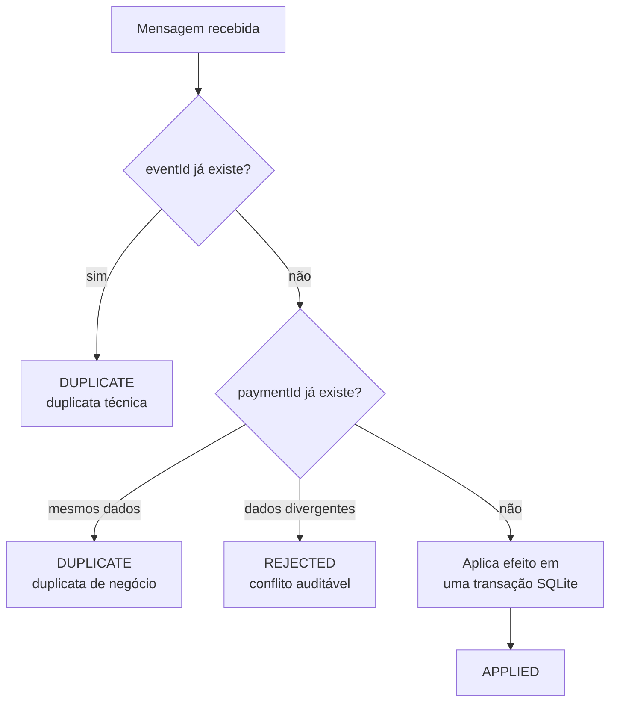
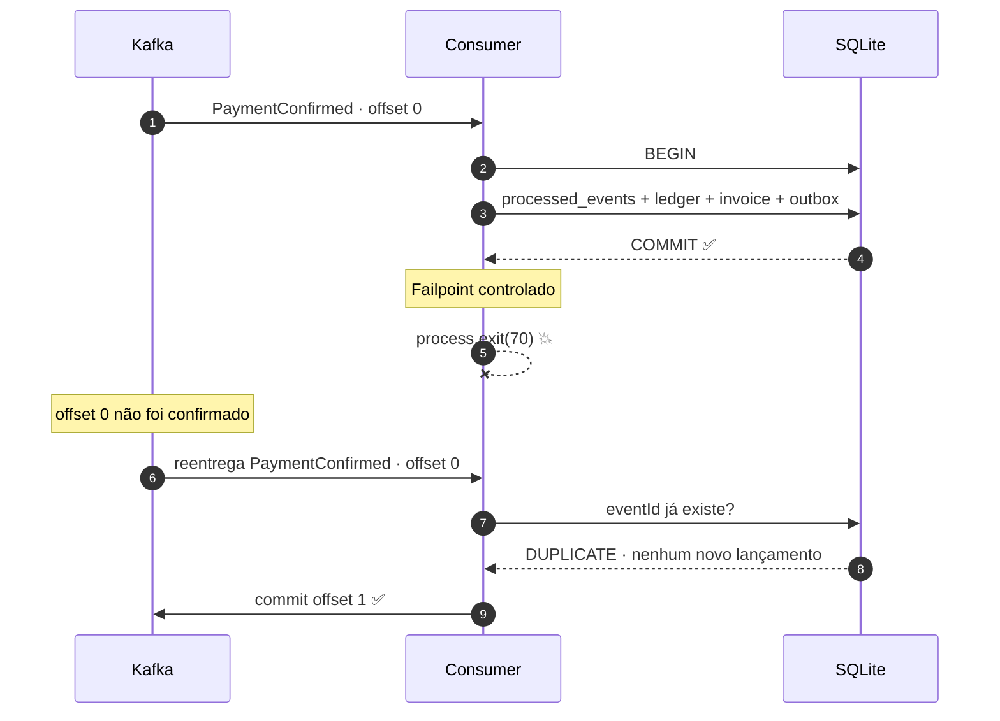
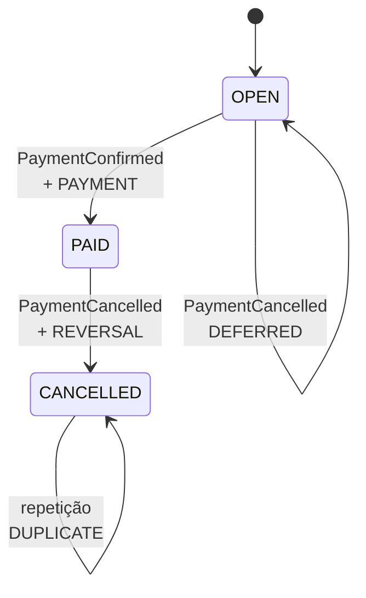
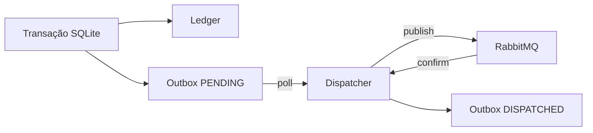

<div align="center">

# 💳 Duplicate Payment Problem

### Idempotência financeira real em uma arquitetura orientada a eventos

**Um pagamento. Cinco entregas. Um único lançamento no ledger.**

<br />


<br />

[Por que existe?](#-o-problema) · [Arquitetura](#-arquitetura) · [Demonstrações](#-demonstrações-reproduzíveis) · [Executar](#-executando-localmente) · [Testes](#-estratégia-de-testes)

</div>

---

## 🎯 O problema

Sistemas orientados a eventos trabalham, em geral, com entrega **at-least-once**. Isso significa que uma mensagem pode reaparecer — inclusive depois de seu efeito já ter sido persistido.

```text
Pagamento de R$ 150 confirmado
             │
             ▼
      consumidor grava no banco ✅
             │
             ▼
      processo cai antes do offset 💥
             │
             ▼
      Kafka entrega novamente 🔁
             │
             ▼
      cobrar duas vezes? NUNCA. 🛡️
```

Esta POC não demonstra apenas publicação e consumo. Ela preserva uma propriedade financeira verificável:

> [!IMPORTANT]
> Um pagamento não pode ser contabilizado duas vezes, independentemente de quantas vezes o evento seja entregue.

### O que a POC prova

| Risco real | Proteção implementada | Evidência |
|:---|:---|:---|
| Mesmo evento entregue 5 vezes | `UNIQUE(eventId)` | 1 entrada `PAYMENT` |
| Eventos diferentes para o mesmo pagamento | `UNIQUE(paymentId, entryType)` | duplicata de negócio |
| Crash depois do banco e antes do offset | commit manual do Kafka | reentrega sem novo efeito |
| RabbitMQ indisponível após o pagamento | transactional outbox | tarefa permanece `PENDING` |
| Falha temporária na notificação | retry com TTL | processamento posterior |
| Falha definitiva ou esgotada | dead-letter queue | mensagem inspecionável |
| Cancelamento chega antes da confirmação | máquina de estados + retenção | pagamento e estorno atômicos |

---

## 🧭 Arquitetura

```mermaid
flowchart LR
    classDef entry fill:#E8F0FE,stroke:#3178C6,color:#102A43
    classDef broker fill:#FFF3E0,stroke:#F57C00,color:#5D2A00
    classDef process fill:#F3E8FF,stroke:#8A2BE2,color:#32105E
    classDef data fill:#E6F4EA,stroke:#2EA44F,color:#123B20
    classDef danger fill:#FDECEC,stroke:#D73A49,color:#5A1018

    API[HTTP API]:::entry
    CLI[Demo CLI]:::entry
    K[Kafka<br/>financial-events]:::broker
    C[Payment Consumer]:::process
    DB[(SQLite<br/>transação local)]:::data
    O[Outbox Dispatcher]:::process
    R[RabbitMQ<br/>main]:::broker
    W[Notification Worker]:::process
    RT[Retry Queue<br/>TTL]:::broker
    DLQ[Dead-letter Queue]:::danger

    API -->|FinancialEvent| K
    CLI -->|cenários controlados| K
    K --> C
    C -->|BEGIN / COMMIT| DB
    DB -->|tarefas pendentes| O
    O -->|publisher confirm| R
    R --> W
    W -->|falha temporária| RT
    RT -->|TTL expirou| R
    W -->|definitiva / esgotada| DLQ
```



### Componentes em uma frase

| Componente | Responsabilidade |
|:---|:---|
| **API** | cria e consulta faturas; publica eventos válidos |
| **Kafka** | distribui eventos financeiros por `invoiceId` |
| **Payment Consumer** | aplica regras financeiras e confirma offsets manualmente |
| **SQLite** | torna ledger, deduplicação, estado e outbox atômicos |
| **Outbox Dispatcher** | publica tarefas com confirmação do RabbitMQ |
| **Notification Worker** | processa tarefas com deduplicação, retry e DLQ |
| **Demo CLI** | reproduz falhas sem depender de timing manual |

---

## 🛡️ A garantia de idempotência

Existem duas duplicações diferentes — e o projeto protege as duas:



| Identificador | Significado | Protege contra |
|:---|:---|:---|
| `eventId` | identidade da mensagem | reentrega do mesmo evento |
| `paymentId` | identidade do pagamento | eventos distintos representando o mesmo efeito |

### A janela crítica de crash



O commit segue uma regra simples e deliberada:

```text
commit SQLite ───────► commit offset Kafka
      obrigatório            somente depois
```

---

## 🔀 Eventos fora de ordem

`occurredAt` é informação de auditoria, não uma fonte confiável de ordenação. A decisão vem do estado persistido da fatura.



| Estado atual | Evento recebido | Resultado |
|:---:|:---|:---|
| `OPEN` | `PaymentConfirmed` | registra `PAYMENT` → `PAID` |
| `PAID` | `PaymentCancelled` | registra `REVERSAL` → `CANCELLED` |
| `OPEN` | `PaymentCancelled` | retém em `pending_events` |
| efeito já aplicado | equivalente | `DUPLICATE`, sem novo ledger |
| estado incompatível | qualquer | `REJECTED`, com motivo |

Quando a confirmação finalmente chega, pagamento e cancelamento pendente são tratados na mesma transação. O ledger continua imutável: o estorno é um novo lançamento e o saldo líquido termina em zero.

---

## 🧪 Demonstrações reproduzíveis

Cada demo cria tópico, consumer group, fatura e identificadores isolados. Não é necessário acertar manualmente o instante de uma falha.

| Demo | Comando | Resultado esperado |
|:---|:---|:---|
| 🔁 **Entrega duplicada** | `npm run demo -- duplicate-delivery` | 5 entregas → 1 pagamento |
| 💥 **Crash crítico** | `npm run demo -- crash-before-offset` | saída `70`, reentrega e ledger intacto |
| 🪪 **Duplicata de negócio** | `npm run demo -- duplicate-payment` | 2 eventos → 1 pagamento |
| ⏳ **Retry de notificação** | `npm run demo -- notification-retry` | falha, TTL e conclusão |
| 🔀 **Fora de ordem** | `npm run demo -- out-of-order` | retenção, pagamento e estorno |

```bash
# Execute o cenário mais importante
npm run demo -- duplicate-delivery
```

<details>
<summary><strong>Exemplo do estado financeiro esperado</strong></summary>

```json
{
  "invoiceId": "inv-456",
  "amount": 15000,
  "currency": "BRL",
  "status": "PAID",
  "ledgerEntries": [
    {
      "paymentId": "pay-789",
      "entryType": "PAYMENT",
      "amount": 15000,
      "currency": "BRL"
    }
  ]
}
```

</details>

> [!CAUTION]
> Não execute demos simultaneamente com outros workers apontando para o mesmo arquivo SQLite. A configuração padrão prioriza uma demonstração local simples e observável.

---

## 🚀 Executando localmente

### Pré-requisitos

- Node.js **22 ou superior**;
- npm;
- Docker com Compose.

### 1. Prepare o ambiente

```bash
git clone <url-do-repositorio>
cd event-driven-orders
npm install
cp .env.example .env
docker compose up -d --wait
npm run migrate
```

### 2. Inicie todos os processos

```bash
npm run start:all
```

| Serviço | Endereço |
|:---|:---|
| API | [`http://localhost:3000`](http://localhost:3000) |
| Health check | [`http://localhost:3000/health`](http://localhost:3000/health) |
| RabbitMQ Management | [`http://localhost:15672`](http://localhost:15672) — `guest` / `guest` |
| Kafka | `localhost:9092` |

### 3. Crie uma fatura

```bash
curl -X POST http://localhost:3000/invoices \
  -H 'content-type: application/json' \
  -d '{"invoiceId":"inv-456","amount":15000,"currency":"BRL"}'
```

### 4. Confirme o pagamento

```bash
curl -X POST http://localhost:3000/events/payment-confirmed \
  -H 'content-type: application/json' \
  -d '{
    "schemaVersion": 1,
    "eventId": "evt-123",
    "eventType": "PaymentConfirmed",
    "invoiceId": "inv-456",
    "paymentId": "pay-789",
    "amount": 15000,
    "currency": "BRL",
    "occurredAt": "2026-10-19T12:00:00.000Z"
  }'
```

### 5. Veja a evidência

```bash
curl http://localhost:3000/invoices/inv-456

sqlite3 data/payments.sqlite \
  "SELECT payment_id, entry_type, amount FROM ledger_entries ORDER BY id;"
```

---

## 📡 API rápida

| Método | Rota | Função |
|:---:|:---|:---|
| `POST` | `/invoices` | cria uma fatura `OPEN` |
| `GET` | `/invoices/:invoiceId` | retorna estado, ledger e eventos pendentes |
| `POST` | `/events/payment-confirmed` | publica `PaymentConfirmed` no Kafka |
| `POST` | `/events/payment-cancelled` | publica `PaymentCancelled` no Kafka |
| `GET` | `/health` | verifica SQLite e conexões com brokers |

<details>
<summary><strong>Contrato PaymentConfirmed</strong></summary>

```json
{
  "schemaVersion": 1,
  "eventId": "evt-123",
  "eventType": "PaymentConfirmed",
  "invoiceId": "inv-456",
  "paymentId": "pay-789",
  "amount": 15000,
  "currency": "BRL",
  "occurredAt": "2026-10-19T12:00:00.000Z"
}
```

</details>

<details>
<summary><strong>Contrato PaymentCancelled</strong></summary>

```json
{
  "schemaVersion": 1,
  "eventId": "evt-456",
  "eventType": "PaymentCancelled",
  "invoiceId": "inv-456",
  "paymentId": "pay-789",
  "cancelsPaymentId": "pay-789",
  "amount": 15000,
  "currency": "BRL",
  "occurredAt": "2026-10-19T12:05:00.000Z"
}
```

</details>

> [!NOTE]
> Valores monetários são inteiros em centavos. `15000` representa **R$ 150,00**, evitando erros de ponto flutuante.

---

## 🐇 Transactional outbox, retry e DLQ

O pagamento nunca depende de uma publicação RabbitMQ acontecer no mesmo instante:



- O dispatcher usa **publisher confirms** antes de marcar a tarefa como `DISPATCHED`.
- Se cair antes da marcação, pode publicar novamente sem perder a tarefa.
- O worker deduplica notificações por `taskId` em `completed_notifications`.
- O header `attempt` controla tentativas; `error` preserva o último motivo.

```text
notifications.main
       │
       ├── sucesso ─────────────────────────► completed_notifications
       │
       └── falha temporária ─► retry + TTL ─► notifications.main
                  │
                  └── definitiva/esgotada ──► notifications.dlq
```

---

## ✅ Estratégia de testes

### Suíte rápida — sem Docker

```bash
npm test
npm run typecheck
npm run build
```

| Camada | Cobertura |
|:---|:---|
| Contrato | centavos, moeda, timestamp e união discriminada |
| Domínio | todas as transições da máquina de estados |
| SQLite real | atomicidade, rollback, deduplicação e outbox |
| RabbitMQ policy | classificação de retry, permanente e esgotamento |

### Integração — brokers reais

```bash
docker compose up -d --wait
npm run test:integration
```

A suíte de integração cria recursos isolados e comprova:

- cinco publicações Kafka resultando em um pagamento;
- crash real entre os dois commits;
- avanço do offset somente depois da reentrega;
- recuperação de tarefa pendente na outbox;
- retry temporário, erro definitivo e tentativas esgotadas na DLQ.

O teste que resume a proposta do projeto é:

```text
should_record_payment_once_even_when_message_is_delivered_multiple_times
```

---

## 🗂️ Estrutura do projeto

```text
event-driven-orders/
├── src/
│   ├── application/       # caso de uso transacional
│   ├── domain/            # contratos e máquina de estados
│   ├── infra/             # SQLite, Kafka e RabbitMQ
│   ├── processes/         # API e processos independentes
│   └── cli/               # migração e demos reproduzíveis
├── test/
│   ├── integration/       # Kafka e RabbitMQ reais
│   └── *.test.ts          # domínio + SQLite real em memória
├── docker-compose.yml
└── .env.example
```

---

## ⚖️ Decisões e trade-offs

| Decisão | Motivo | Limitação consciente |
|:---|:---|:---|
| SQLite | atomicidade visível e setup mínimo | não representa alta concorrência de escrita |
| commit manual Kafka | expõe claramente a janela de falha | exige disciplina no consumidor |
| `eventId` + `paymentId` | cobre duplicação técnica e de negócio | regras dependem do domínio |
| transactional outbox | evita transação distribuída | entrega da tarefa continua at-least-once |
| retenção de cancelamento | trata ordem como regra de estado | requer armazenamento de pendências |
| RabbitMQ para tarefas | retry e DLQ explícitos | dois brokers aumentam custo operacional |
